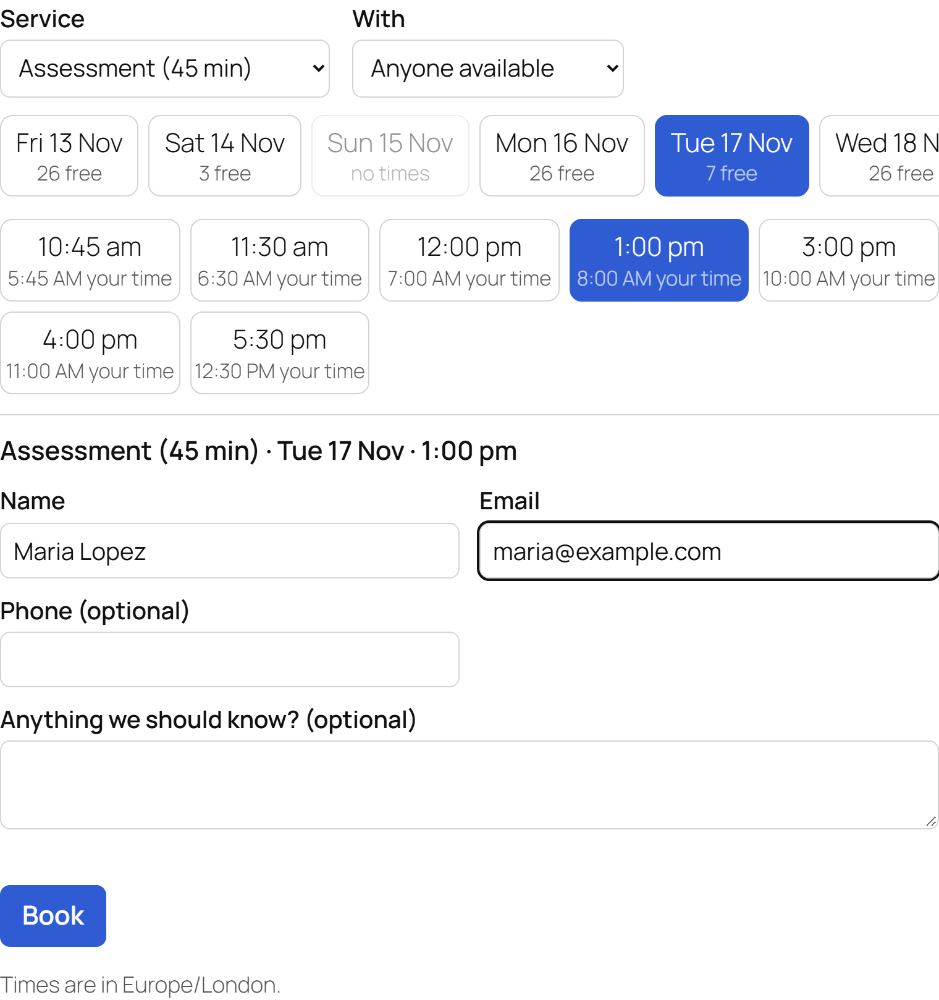
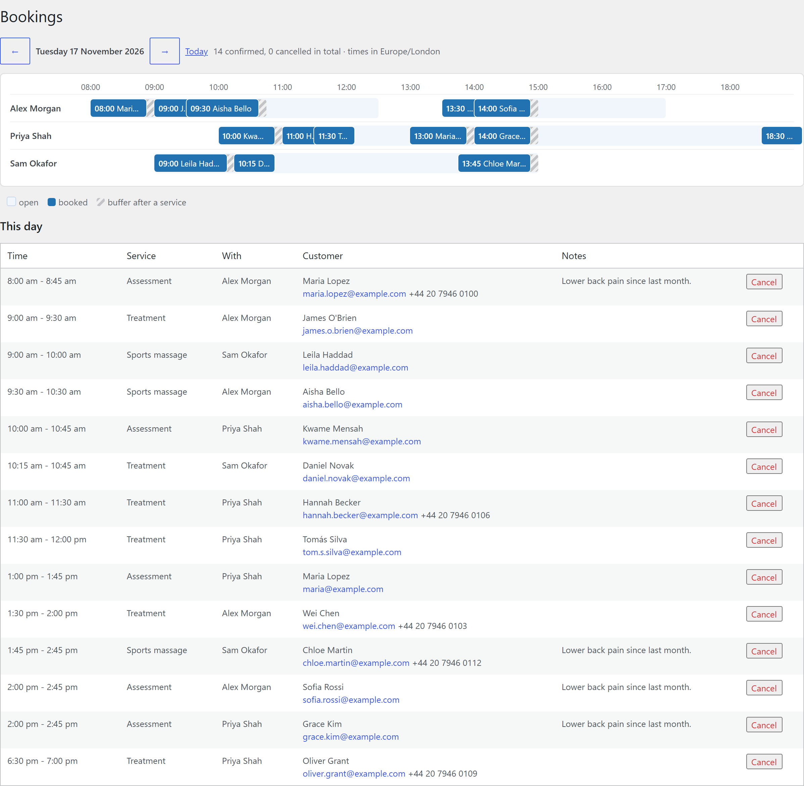
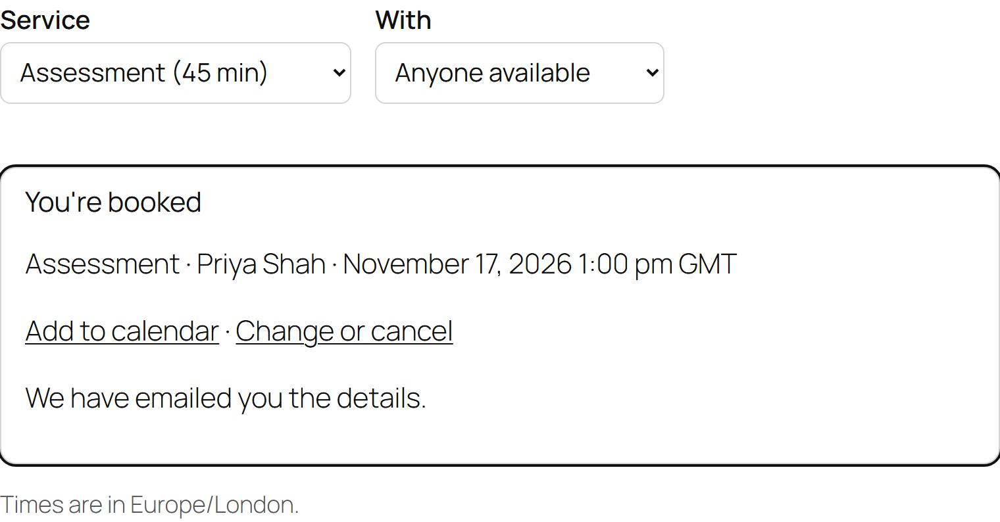

# Appointment Booking for WordPress

[](https://github.com/codeROCK-IZZY/wordpress-appointment-booking/actions/workflows/ci.yml)


A WordPress booking plugin for clinics, salons, tutors and other businesses that sell time. Customers pick a
service, a person (or anyone), a day and a free time, and get a confirmation email with a calendar invite and a link
to cancel. Staff see the day as a timeline.

It is built around three ways booking systems quietly let a business down:

- **Two customers get the same time.** Two people press "Book" at the same moment. Each request checks, sees the
  time free, and inserts a booking. This plugin claims time atomically in the database, so one of them always loses
  cleanly.
- **The hours are an hour out after the clocks change.** Code that works out the UTC offset once (or a site set to
  "UTC+1" instead of a city) shows the wrong times for half the year. Here, opening hours are wall-clock times,
  resolved for each date.
- **The diary looks full, but staff stand idle.** Offering every 15-minute start lets bookings strand gaps too short
  to sell. Gap-aware offering only shows starts that leave usable gaps.



## Results

**Double bookings under concurrent requests** (`tests/integration/run.sh`, real WordPress and MariaDB in Docker,
over HTTP). In each round, 30 requests arrive at once for the same person: half for a 60-minute treatment at 10:00,
half for a 30-minute consultation at 10:30, which overlaps it.

| Storage (10 rounds of 30 simultaneous requests) | Double bookings | Rounds with a double booking |
|---|---:|---:|
| Check for an overlap, then insert (the usual approach) | 3 | 2 of 10 |
| **Atomic claims (this plugin)** | **0** | **0 of 10** |

The race is intermittent, which is why it survives testing and turns up on a busy morning. CI runs the same test on
every push against WordPress 6.5 and the latest release. It fails the build if atomic claims ever let a double
booking through, and prints the check-then-insert count for comparison.

**Opening hours across daylight saving** (`php eval/run.php`). A business opens 09:00-17:00 local every day of
2026 in twelve timezones (4,380 days). Every start time is converted back to local time with PHP's timezone
database and checked.

| | Days with wrong start times |
|---|---:|
| Offset worked out once (or a fixed "UTC+1" site timezone) | 1,645 (154 to 238 a year in each of the 8 zones that change clocks) |
| **This plugin** | **0** |

**Which start times to offer** (`php eval/run.php`). Simulated businesses (salons, clinics, spas and tutors) take
bookings for two weeks with more demand than they can serve. The threshold was chosen on 20 tuning businesses.
These are **30 held-out businesses**:

| Times offered (held-out) | Customers booked | Staff time booked | Revenue | Times shown per customer |
|---|---:|---:|---:|---:|
| Every start time that fits (common default) | 65.5% | 66.8% | $472,335 | 16.0 |
| Fixed grid the length of the service | 63.8% | 63.4% | $450,400 | 7.4 |
| **Gap-aware (this plugin)** | **67.1%** | **69.6%** | **$490,425** | 9.6 |

What the numbers show:

- **Gap-aware offering helps, modestly.** It books 1.6 points more customers and earns 3.8% more from the same staff
  hours, while showing fewer, better-placed times. On a held-back shape (more staff, 10-minute slots, heavier
  demand, narrower windows) it adds 1.9 points.
- **It is not the main reason diaries have empty time.** Even at its best, about 30% of open time goes unbooked
  while customers are turned away, because demand clusters on certain days and hours. A waitlist or pricing would do
  more than slot placement (see [known limitations](docs/known-limitations.md)).
- **Giving "anyone" bookings to the best-fitting person made no measurable difference** (67.1% either way). It is
  kept, but no gain is claimed for it.

Full tables: [eval/reports/report.md](eval/reports/report.md).



## How it works

```
widget ─► GET /abk/v1/days, /slots ─► Availability: opening hours resolved for that date in the business timezone
                                        − confirmed bookings (with their buffers) − minimum notice
                                        ─► SlotPolicy (gap-aware: keep starts leaving no gap or ≥ 3× the shortest service)
       ─► POST /abk/v1/bookings ─► validate ─► is the time still offered? (409 if not)
                                 ─► claim: INSERT booking (pending) + ONE multi-row INSERT of its 5-minute units
                                           into a table keyed (staff, unit) ─► duplicate key = lost the race (409)
                                 ─► confirmed ─► emails with a .ics file and a signed manage link
```

- **Core** (`src/Core`). Hours, availability, slot policies, the booking flow, ICS files and tokens, with no WordPress
  calls. It is unit-tested and used directly by the evaluation.
- **Atomic claims** (`src/Data/WpdbStore.php`). See [ADR 1](docs/adr/0001-atomic-claims-not-check-then-insert.md).
- **Hours across DST** (`src/Core/Availability.php`). See [ADR 2](docs/adr/0002-wall-clock-hours-per-date.md).
  The settings page warns if the site's timezone is a fixed offset.
- **Gap-aware times** (`src/Core/SlotPolicy.php`). See [ADR 3](docs/adr/0003-gap-aware-start-times.md).
- **Customers without accounts** can view and cancel through a signed link (HMAC of the booking id and email). The
  link works without JavaScript; online cancelling closes at the minimum-notice cutoff.
- **WordPress integration.** A dynamic block and shortcode (no build step), REST routes, `admin-post` handlers with
  nonces and capability checks, hourly reminders through WP-Cron, privacy export and erasure, and a clean uninstall.
  Strings are translatable.



Decisions: [docs/adr](docs/adr). Gaps: [docs/known-limitations.md](docs/known-limitations.md).

## Run it

```bash
composer install
vendor/bin/phpunit                 # unit tests (WordPress-free core)
vendor/bin/phpcs                   # WordPress coding standards
vendor/bin/phpstan analyse         # level 8 with WordPress stubs
php eval/run.php --gate            # eval/reports/report.{md,json,html}

docker compose up -d && bash tests/integration/run.sh    # inside WordPress, then concurrency over HTTP
# open http://127.0.0.1:8080 (admin / admin); `docker compose exec cli wp eval-file
#   wp-content/plugins/appointment-booking/tests/integration/demo.php` seeds a demo practice
```

## Tests and CI

- **Unit:** hours parsing, configuration errors, DST on both changes, closures, notice, buffers, every policy,
  invalid input per field, a lost race reported as "taken", units that make any overlap collide, best-fit
  assignment, ICS escaping, CRLF and UTF-8-safe folding, and token forgery.
- **Integration (real WordPress):** REST routes, block and shortcode rendering, booking, refusals for taken times and
  buffers, the honeypot, emails with calendar files, the manage link, forged tokens, cancelling (which frees the
  time), reminders, privacy export and erasure, settings sanitising, DST, and uninstall. Then the concurrency test
  over HTTP.
- **CI:** WPCS and PHPCompatibility, PHPStan level 8, JavaScript syntax, PHPUnit on PHP 8.1 to 8.4, the evaluation
  gate, the integration suite on WordPress 6.5 and the latest release, and a gitleaks scan of the full history.

## License

GPL-2.0-or-later
